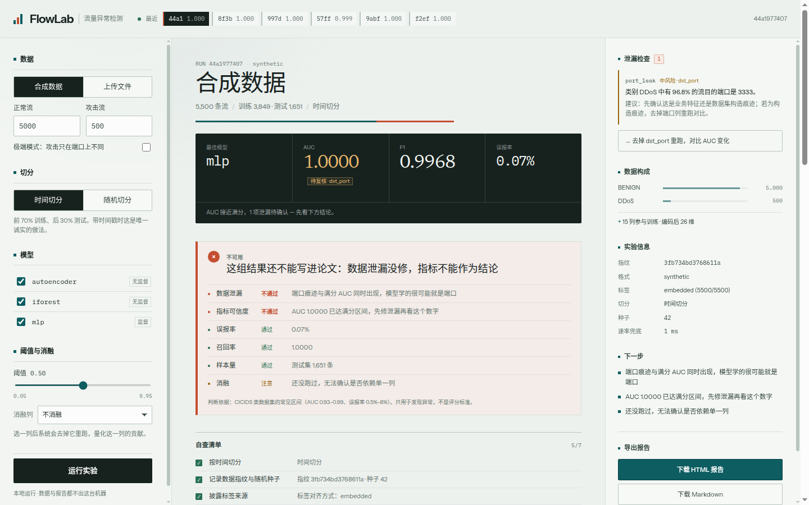

# FlowLab · Network Traffic Anomaly Detection Workbench

[](https://github.com/ZhuQuan181/traceledger/actions/workflows/ci.yml)
[](https://zhuquan181.github.io/traceledger/en/)
[](https://www.python.org/)
[](https://react.dev/)
[](LICENSE)

**Language:** [中文](README.md) | **English**

> Working name (placeholder). One line: **turn network traffic anomaly detection research models into systems that run, reproduce, and explain.**

- Created: 2026-11-11
- Status: **v0.5** (2026-11-14: UI/UX redesign; 102 tests, pcap tests require tshark)
- Documentation: Chinese and English READMEs, with design docs in Chinese; code and interfaces are in English
- Project site: https://zhuquan181.github.io/traceledger/en/
- Sample report: https://zhuquan181.github.io/traceledger/demo-report.html

[](https://zhuquan181.github.io/traceledger/en/)

## Quick start

```bash
# 0) Install uv if needed: https://docs.astral.sh/uv/getting-started/installation/
git clone https://github.com/ZhuQuan181/traceledger.git
cd traceledger
uv sync --extra dev --extra api --extra data

uv run flowlab sample --rows 2000          # Generate a sample CSV
uv run flowlab demo                        # Run the full pipeline on synthetic data
uv run flowlab demo --report out/report.md # Also write a Markdown report
uv run flowlab run my.csv --split temporal # Run your own CSV (requires a label column)
uv run flowlab run cap.pcap                # Auto-align cap.pcap.labels.csv
uv run flowlab run cap.pcap --labels l.csv # Or pass a label file explicitly
uv run flowlab run feats.npz               # npy / npz / parquet / json / jsonl / pkl / xlsx
uv run flowlab run model_input.pkl --allow-pickle   # pickle requires explicit consent
uv run flowlab score cap.pcap --top 20     # Score unlabeled flows without ground truth
uv run flowlab serve                       # Web workbench at 127.0.0.1:8765

uv run python scripts/check_dataset.py data.csv        # Pre-training data check
uv run python scripts/bench_scale.py --rows 690000     # Scale benchmark
cd web && npm ci && npm run build          # Rebuild the frontend
```

`pcap` ingestion requires `tshark` (Ubuntu: `sudo apt install tshark`).
Zeek `conn.log` files can be read directly (`.log` / `.log.gz`); pass sidecar labels with `--labels`.

## Commands

| Command | Purpose |
|---|---|
| `flowlab demo` | Run the full pipeline on synthetic data (5,000 normal + 500 attack flows by default) |
| `flowlab run FILE` | Run an experiment on CSV / pcap / Zeek conn.log; requires a `label` column |
| `flowlab score FILE` | Rank unlabeled flows with an unsupervised model |
| `flowlab run FILE --labels L` | Attach labels to pcap flows by `flow_id`, five-tuple, or row order |
| `flowlab serve` | Start the local Web workbench |
| `flowlab sample` | Generate a sample CSV for testing or sharing |
| `flowlab formats` | List supported input formats |
| `flowlab models` | List registered models |
| `flowlab history` | Recent experiments stored in local SQLite (`~/.flowlab/flowlab.db`) |
| `flowlab history --prune 20` | Keep only the 20 most recent runs |
| `flowlab show ID` | Inspect a run and export Markdown / HTML |
| `flowlab compare ID1 ID2` | Compare best metrics across runs |

Shared flags: `--models mlp,iforest`, `--split temporal|random`, `--seed`, `--threshold`,
`--ablate COLUMN` (drop one column and rerun to quantify its contribution),
`--html PATH` (standalone HTML), `--report PATH` (Markdown), `--json`, `--no-save`.

## Project site and CI

- **CI**: runs the full suite on Python 3.11 and 3.13, then builds the frontend with `npm ci && npm run build`
- **Pages**: deploys the static project site in `site/` plus a real generated report
- **Local workbench**: GitHub Pages hosts the introduction only; the full Web UI needs the local Python backend (`flowlab serve`)

## Architecture

```
CSV / pcap
   ↓ ingest        normalize columns, sniff delimiters/encoding, aggregate five-tuples
   ↓ features      leakage checks → preprocessors fitted on the training split only
   ↓ models        plugin registry (mlp / iforest / autoencoder / your model)
   ↓ eval          temporal/random split → AUC · F1 · FPR · confusion matrix
   ↓ report/api    fingerprint, seed, feature list, class distribution, confusion matrix
  ↓ store          local SQLite experiment history (never uploaded)
```

Shared loading pipeline for CLI and API:

```
read file → normalize columns → attach labels (optional) → feature engineering (1 ms rate floor, bytes_per_pkt)
```

Adding a model takes one file. Any module placed under `src/flowlab/models/` is discovered automatically:

```python
from flowlab.models.base import Detector
from flowlab.models.registry import register

@register("your_model")
class YourDetector(Detector):
    kind = "supervised"
    def fit(self, X, y): ...
    def score(self, X): ...   # return [0, 1]; higher means more suspicious
```

## What this project solves

Researchers in traffic anomaly detection spend most of their time not on models, but on finding datasets,
writing preprocessing code, aligning features, and reproducing someone else's F1.
Security operators, meanwhile, receive a rule alert or a single score without a clear answer to
"why is this suspicious, and what should I do next?"

The missing layer is the one that **puts a model into a system, turns results into an explanation,
and makes the experiment reproducible**.

## Documentation

The design documents are currently written in Chinese.

| File | Purpose |
|---|---|
| `01-问题陈述.md` | Problem statement, users, and evidence |
| `02-用户画像与场景.md` | User personas, JTBD, and alternatives |
| `03-竞品快照.md` | Competitive snapshot and gap analysis |
| `04-PRD.md` | Goals, non-goals, user stories, and acceptance criteria |
| `05-MVP范围与里程碑.md` | MVP scope and milestone plan |
| `06-验证实验-PoL-Probe.md` | Three-day demand-validation probe |
| `07-技术架构与数据流.md` | Technical architecture and data flow |
| `08-指标与成功标准.md` | Success metrics and instrumentation plan |
| `09-开放问题.md` | Open decisions |

## Established facts

- Open-source projects are mature at the **collection layer** (Zeek/Suricata/nDPI/ntopng) and the **algorithm layer** (Kitsune/Slips/paper code).
- A GitHub search for `ml nids platform` surfaced very little work connecting models to systems.
- Available assets include SPIN-OW models and baselines (ISCX-APP / ISCX-SERVICE / ISCX-TOR / USTC-2016), a workstation with 22 GB of VRAM, and local deployment experience.

## Decisions (2026-11-11)

| Decision | Result |
|---|---|
| Primary user | **Security researchers** (Persona A); teachers and small teams are secondary |
| License | **Apache-2.0** |
| SPIN-OW weights | **Not bundled**; an integration template is provided |
| Input formats | **CSV and pcap** (pcap parsed offline with tshark/nDPI) |
| Project execution | Milestone-driven; decisions and acceptance happen at key checkpoints |

## Three principles

1. **Work with Zeek/Suricata, not against them** — treat their output as input.
2. **Reproducibility before real-time** — researchers care about reproducing results, not line-rate throughput.
3. **Every feature must answer "which user would spend another 30 minutes on this?"** — otherwise, cut it.
