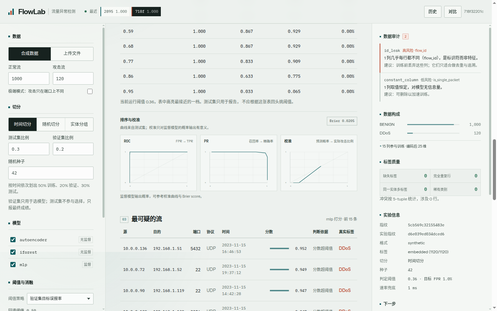

# FlowLab · 流量异常检测研究台

[](https://github.com/ZhuQuan181/traceledger/actions/workflows/ci.yml)
[](https://zhuquan181.github.io/traceledger/)
[](https://github.com/ZhuQuan181/traceledger/releases/latest)
[](https://www.python.org/)
[](https://react.dev/)
[](compose.yaml)
[](LICENSE)

> **把网络流量异常检测的研究模型，变成能跑、能复现、能解释的系统。**

- 创建：2026-11-11
- 当前版本：**v0.8.0**（2026-11-15：跨实验对比、标签质量诊断、历史检索与容量管理、ROC/PR/校准曲线、运行环境清单）
- 测试：**168 个后端测试 + 26 个前端测试**；pcap 测试需要本机 `tshark`
- 文档语言：中文为主，提供英文 README；代码与接口用英文
- 在线项目页：https://zhuquan181.github.io/traceledger/
- 示例报告（合成数据）：https://zhuquan181.github.io/traceledger/demo-report.html
- 其他语言：[English](README.en.md)

[](https://zhuquan181.github.io/traceledger/)

## 快速开始

环境要求：Python 3.11+、[uv](https://docs.astral.sh/uv/)；修改前端需要 Node.js 22.12+；
读取 pcap 需要 `tshark`。

```bash
git clone https://github.com/ZhuQuan181/traceledger.git
cd traceledger
uv sync --extra dev --extra api --extra data

uv run flowlab sample --rows 2000          # 生成一份样例 CSV（可直接给同事）
uv run flowlab demo                        # 合成数据跑一次
uv run flowlab demo --report out/report.md --html out/report.html
uv run flowlab run my.csv --split temporal # 跑自己的 CSV（需要 label 列）
uv run flowlab run my.csv --split group     # 按实体分组，评估新主机/新会话泛化
uv run flowlab run my.csv --threshold-mode f1  # 只用验证集选择阈值
uv run flowlab run cap.pcap                # pcap + 同名 cap.pcap.labels.csv 自动对齐
uv run flowlab run cap.pcap --labels l.csv # 或显式指定标签文件
uv run flowlab run feats.npz              # npy / npz / parquet / json / jsonl / pkl / xlsx
uv run flowlab run model_input.pkl --allow-pickle   # pickle 需显式许可
uv run flowlab score cap.pcap --top 20     # pcap 只打分（无标签）
uv run flowlab serve                       # Web 界面 127.0.0.1:8765

uv run python scripts/check_dataset.py data.csv        # 训练前体检：类别/缺失/inf/重复
uv run python scripts/bench_scale.py --rows 690000     # 规模基准（解析/特征/训练耗时）
cd web && npm ci && npm run build          # 改前端后重新构建
```

pcap 需要本机 `tshark`（Ubuntu: `sudo apt install tshark`）。
Zeek `conn.log` 可直接读（`.log` / `.log.gz`），标签用 `--labels` 旁挂。

### Docker

```bash
docker compose up --build                 # http://127.0.0.1:8765
docker compose down                       # 实验历史保留在 flowlab-data 卷中
```

Docker 镜像同时包含 Python API 和构建后的 Web UI；容器默认只映射到本机回环地址。

## 命令

| 命令 | 作用 |
|---|---|
| `flowlab demo` | 合成数据跑全流程（默认 5000 正常 + 500 攻击） |
| `flowlab run FILE` | 对 CSV / pcap / Zeek conn.log 跑实验，要求有 `label` 列 |
| `flowlab score FILE` | 无标签数据的无监督排序，输出最可疑的流 |
| `flowlab run FILE --labels L` | pcap 旁挂标签（flow_id / 五元组 / 行序三种对齐） |
| `flowlab serve` | 本地 Web 工作台 |
| `flowlab sample` | 生成样例 CSV，用来试跑或分发 |
| `flowlab formats` | 列出支持的数据格式 |
| `flowlab models` | 列出已注册模型 |
| `flowlab history` | 最近的实验（本地 SQLite，`~/.flowlab/flowlab.db`） |
| `flowlab history --prune 20` | 只保留最近 20 条，其余删除 |
| `flowlab show ID` | 回看某次实验，可导出 MD / HTML |
| `flowlab compare ID1 ID2` | 跨实验对比最佳指标 |

通用参数：`--models mlp,iforest`、`--split temporal|random|group`、`--test-size`、
`--validation-size`、`--threshold-mode fixed|f1`、`--threshold`、`--seed`、
`--ablate COLUMN`（去掉某列重跑，量化它撑了多少指标）、`--html PATH`（单文件报告）、
`--report PATH`（Markdown）、`--json`、`--no-save`。

## 项目页与 CI

- **质量门禁**：Ruff 检查与格式校验；Python 3.11 / 3.13 跑完整后端测试
- **前端**：组件测试、全量依赖审计、生产构建
- **打包**：同时验证“没有前端产物的源码 checkout 可安装”和“发布 wheel 内置 Web UI”
- **容器**：每次 CI 都执行 Docker build
- **Pages**：部署中英文项目页和一份由合成数据生成的静态示例报告
- **本地工作台**：Pages 只承载介绍页；完整 Web 工作台需要本机 Python 后端（`flowlab serve`）

## v0.8 的重点

- **跨实验对比**：选择 2–4 次实验，先核对数据指纹、特征矩阵、切分、验证集规模和阈值策略，再比较验证/测试指标与差值；可导出 Markdown。
- **历史工作流**：按来源、模型、状态和备注检索，分页浏览，添加“基准/失败/归档”状态与备注，单条删除，按保留数量清理旧记录。
- **数据质量**：在报告中单独列出标签覆盖、重复行、五元组多标签冲突和极小类别，避免把数据问题误读成模型问题。
- **诊断能力**：新增目标 FPR 阈值、ROC/PR 曲线、校准曲线、Brier score 和模型参数表。
- **可复现环境**：报告记录 FlowLab、Python、pandas、NumPy、scikit-learn 版本，并把环境纳入实验指纹。
- **界面与安全**：历史与对比弹窗支持窄屏；自查清单默认折叠；本机 API 增加 Host 白名单与安全响应头。

更完整的后续优先级和验收标准见 [优化路线图](docs/OPTIMIZATION-ROADMAP.md)。

## 架构

```
CSV / pcap
   ↓ ingest        列名标准化、分隔符/编码嗅探、五元组聚合
   ↓ features      泄漏检测 → 训练/测试分离的预处理
   ↓ models        registry 插件（mlp / iforest / autoencoder / 你的）
   ↓ eval          时间/随机/实体切分 → 验证集选模 → 测试集指标·诊断曲线·标签质量·调查线索
   ↓ report/api    报告含：指纹、运行环境、种子、特征清单、类别分布、混淆矩阵、复现命令
  ↓ store         SQLite 实验历史（本地，不上传）
```

加载管线（CLI 与 API 共用）：

```
读文件 → 列名标准化 → 旁挂标签（可选）→ 特征工程（速率兜底 1ms、bytes_per_pkt）
```

新增模型只要一个文件，放进 `src/flowlab/models/` 就会被自动发现：

```python
from flowlab.models.base import Detector
from flowlab.models.registry import register


@register("your_model")
class YourDetector(Detector):
    kind = "supervised"

    def fit(self, X, y): ...
    def score(self, X): ...  # 返回 [0,1]，越大越可疑
```

## 这个项目要解决什么

做流量异常检测研究的人，80% 的时间不在想模型，而在：找数据集 → 写预处理 → 对齐特征 → 复现别人的 F1。
做安全运维的人，拿到的是规则告警或一个分数，不知道"为什么可疑、该干什么"。

两边中间缺一层：**能把模型装进系统、把结果讲成人话、把实验做成可复现的那层。**

## 文档导航

| 文件 | 用途 | 对应 PM 方法 |
|---|---|---|
| `01-问题陈述.md` | 问题是什么、为谁、证据 | problem-statement |
| `02-用户画像与场景.md` | 三类用户、JTBD、现有替代方案 | proto-persona + jobs-to-be-done |
| `03-竞品快照.md` | 13 个相关项目逐条对比 + 空白判断 | competitive-research-snapshot |
| `04-PRD.md` | 目标、非目标、用户故事、验收标准 | prd-development |
| `05-MVP范围与里程碑.md` | 做什么/不做什么、6 周排期 | roadmap + user-story-splitting |
| `06-验证实验-PoL-Probe.md` | 3 天验证"有没有人真的痛" | pol-probe |
| `07-技术架构与数据流.md` | 系统怎么搭（补"没做过系统"的短板） | 工程文档 |
| `08-指标与成功标准.md` | 怎么算成功、怎么埋点 | derisk-measurement-advisor |
| `09-开放问题.md` | 还没定的决策，逐条待决 | — |
| `docs/OPTIMIZATION-ROADMAP.md` | 后续优化优先级、验收标准与非目标 | — |
| `CHANGELOG.md` | 版本变更记录 | — |
| `CONTRIBUTING.md` | 本地开发、测试与提交约定 | — |
| `SECURITY.md` | 威胁边界与漏洞报告方式 | — |

## 已确认的事实（不是假设）

- 现有开源项目在**采集层**（Zeek/Suricata/nDPI/ntopng）和**算法层**（Kitsune/Slips/论文代码）都很成熟；
- 但用 `ml nids platform` 搜索 GitHub，**最高只有 1 星**——"模型 → 系统"这层几乎无人做；
- 我们手上已有：SPIN-OW 的模型与基线实验（ISCX-APP / ISCX-SERVICE / ISCX-TOR / USTC-2016）、22 GB 显存工作站、单文件打包与本地部署能力。

## 已定决策（2026-11-11）

| 决策 | 结果 |
|---|---|
| 首要用户 | **安全方向研究者**（Persona A）；教师/中小企业为次要 |
| 许可证 | **Apache-2.0** |
| SPIN-OW 权重 | **不内置**，只提供接入模板 |
| 输入格式 | **CSV + pcap 都要**（pcap 当前用 tshark 离线解析；nDPI 为后续可选） |
| 项目执行 | 按里程碑推进，用户在关键节点做决策与验收 |

## 三条原则

1. **不替代 Zeek/Suricata，配合它们**（把它们的输出当输入）；
2. **先做"可复现"，再做"实时"**（研究者的痛点在复现，不在吞吐）；
3. **每个功能都要能回答"哪个用户会为它多花 30 分钟"**，否则砍掉。
